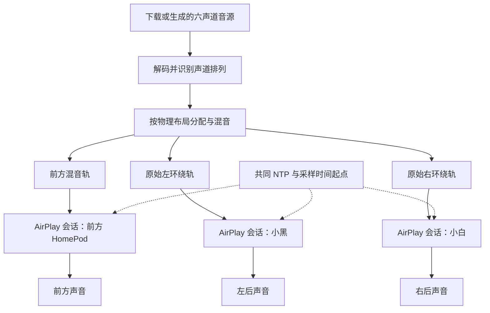

# HomePod Spatial Router：实现方案与测试记录

**版本：** v0.1（技术原型验证）  
**记录日期：** 2026 年 11 月 4 日，Asia/Shanghai  
**目标产品平台：** macOS  
**本次实际验证平台：** Windows，Python 3.10.0  
**适用范围：** 本次三台设备、当前局域网与当前代码版本。

## 1. 结论与证据范围

**已初步跑通：真实 5.1 音源 → 在电脑上分配声道 → 三台独立 HomePod 播放不同内容 → 短时听感基本同步。可以据此进入软件原型开发。**

当前成功路线是三台音箱分别建立连接。两台 mini 已解除原生立体声配对；立体声对路线没有验证成功。

| 能力 | 当前结论 | 依据 |
|---|---|---|
| 前方 HomePod 实际出声 | 通过 | 用户确认 ALAC 语音测试有声音 |
| 两台独立 mini 分别出声 | 通过 | 左后小黑、右后小白报号，用户确认“都听到了” |
| 取得真实 5.1 独立声道并分配 | 通过文件级验证 | 下载源解码确认为六声道，生成不同内容的输出文件 |
| 三台同时发送不同内容 | 发送流程通过 | 三个独立会话及各自音轨的运行记录 |
| 三台短时听感同步 | 初筛通过 | 15 秒不同音调测试，用户反馈基本同步 |
| 毫秒级实际出声误差 | 尚未形成正式结论 | 已收到录音并做初步分析，阈值、回声影响及误差尚未完成审定 |
| 长时间不漂移、重复启动稳定性 | 未验证 | 当前没有对应的完整测试证据 |
| 暂停续播、拖动、断线恢复 | 未实现或未验证 | 一次性文件发送原型不能证明这些能力 |
| Mac 浏览器和应用声音实时接管 | 未实现 | 当前输入是预先解码、分配好的文件 |

“通过”需要区分文件级检查、发送端记录、用户听感和声学测量。**本次没有证据支持“绝对同步”“零延迟”或“全部 P0 已验收通过”。**

## 2. 设备与环境

### 2.1 最终有效布局

| 物理位置 | 名称／型号 | 测试时 IPv4 地址 | 最终连接方式 |
|---|---|---|---|
| 屏幕前方 | 客厅／HomePod 二代 | `192.168.0.104` | 独立 AirPlay 会话 |
| 沙发左后方 | HomePod mini 小黑 | `192.168.0.113` | 独立 AirPlay 会话 |
| 沙发右后方 | HomePod mini 小白 | `192.168.0.111` | 独立 AirPlay 会话 |

左右位置由用户确认。IP 是测试现场记录，可能随 DHCP 分配变化；正式软件应通过设备标识和发现结果管理，不能把这些 IP 硬编码为产品逻辑。

### 2.2 实际运行环境

- Windows 原生 Python 隔离环境 `.venv`；没有通过 WSL 或 Docker 运行本次成功测试。
- `pyatv==0.18.0` 为实际使用的设备发现、连接和 AirPlay 传输基础。
- `srptools==1.0.1` 为兼容性固定版本；尝试自动安装的 2.0.0 时出现 SRP 构造函数接口不兼容。
- 发送侧使用 44.1 kHz、16-bit、双声道音频包。单台独立音箱负责单声道内容时，将相同信号填入该路的左右通道。
- 分析工具为 PyAV、NumPy、SciPy、Matplotlib。完整安装版本、代码散列见[环境与证据索引](evidence/2026-11-04/index.json)。
- Windows 未枚举到可用录音输入，默认录音设备打开失败；后续由用户用手机录音。
- macOS 与全部 HomePod 固件版本未形成完整固定快照，本结论不能扩展为跨系统版本兼容保证。

## 3. 实际实现架构



当前原型有两个阶段：先离线生成等长输出文件，再同时发送。**尚未实现从 Mac 实时捕获音频、边拆声道边持续推送的完整流水线。**

### 3.1 声道识别与分配

支持的测试输入包括：

- 六声道 FLAC／WAV：`FL、FR、FC、LFE、BL、BR`。
- 本次音乐 AC-3：解码确认为 `5.1(side)`，排列为 `FL、FR、FC、LFE、SL、SR`。

对于音乐样本，实际分配如下：

| 输入声道 | 最终用途 |
|---|---|
| FL：前方左 | 混入前方 HomePod |
| FR：前方右 | 混入前方 HomePod |
| FC：中置 | 混入前方 HomePod |
| LFE：低频效果 | 衰减后混入前方 HomePod |
| SL：左环绕 | 送左后小黑 |
| SR：右环绕 | 送右后小白 |

音乐试听代码实际采用：

```text
前方 = 0.45 × (0.5×FL + 0.5×FR + 0.7071×FC + 0.3162×LFE)
小黑 = 0.45 × SL
小白 = 0.45 × SR
```

共同增益用于保留混音余量。生成文件时检查输出峰值，避免数字削波。电影样本使用原始 BL／BR 作为后方；原型的不同准备脚本不保证采用完全相同的增益策略，应以各自 `manifest.json` 为准。

这保留了原曲已有的环绕信息，未使用人声分离或立体声上混算法。“中置”是否包含人声取决于原曲混音；音乐中不能保证全部人声都只在中置。

**布局取舍：** 前方只有一台音箱，因此 FL、FR 被合并；三台设备不是具有六个实体扬声器的标准 5.1 系统。音乐源中的侧环绕在这里由沙发两侧／后方的 mini 承担。生成的六声道 WAV 为便于现有准备工具处理，可将这两个输出位置表示为 BL／BR；源文件原始 SL／SR 信息保留在清单中。

### 3.2 AirPlay 传输机制从哪里来

实际使用的是 **pyatv 的 AirPlay 2／RAOP 流式发送实现**，并在进程内适配其内部接口。没有修改安装目录里的 pyatv 文件。

本次适配重点：

1. 使用 ALAC 音频格式替换默认原始 PCM。
2. 等待所有输出完成播放准备，再赋予共同的播放时间起点。
3. 将不同输出文件交给各自设备会话。

OwnTone 源码虽然已下载并用于协议研究，但**没有参与本次实际成功的 Windows 发送流程**，不能把此次结果记为 OwnTone 实测通过。

### 3.3 ALAC 适配为什么重要

默认 PCM 发送曾正常结束，也收到 HomePod 计时回应，但用户多次反馈没有声音。将传输改为 ALAC 后，用户确认“这次有声音了”。

`alac_adapter.py` 的处理方式：

- 在音频流 SETUP 中声明 `audioFormat=0x40000`、`ct=2`，即 44.1 kHz／16-bit／双声道 ALAC。
- 将 pyatv 提供的大端、16-bit、双声道 PCM 包装为 ALAC verbatim（不做压缩预测的合法 ALAC 帧）。
- 帧封装在原有加密与发送步骤之前完成；连接、认证、加密、网络发送和重传等继续使用库已有实现。

这不等于把所有网络传输逻辑重新实现了一遍，也不等于取得苹果官方发送端 SDK。对当前固件的兼容性来自本次实测。

## 4. 同步是如何实现的

### 4.1 当前代码实际做了什么

`sync_probe.py` 内的 `SharedTimeline` 通过进程内适配完成：

1. 每个设备独立连接、初始化音频流、读取自己的音轨。
2. 暂缓原库启动同步消息的步骤。
3. 各会话进入实际数据发送步骤时先等待其他会话就绪；准备超时则失败。
4. 检查各路采样率、通道数、采样字长和协议延迟一致。
5. 读取一次共同 NTP 时间，转换成各路采样时间，设置相同的 `start_ts` 与 `head_ts`。
6. 启动各路原有同步消息与音频发送循环。

对第 n 个采样，设计目标是让各路都映射到共同的播放起点加 `n / 44100`。**采样内容可以不同，媒体时间对应关系必须一致。**

当前代码继承的协议延迟为 66,150 个采样，即约 **1.5 秒**。这是发送实现中的缓存／调度参数，不是本次测得的端到端延迟，更不是三台音箱之间相差 1.5 秒。

### 4.2 当前实现的限制

- 共同起点和周期同步消息已经实现，但每路仍沿用 pyatv 自己的发送循环。
- 尚未实现由本项目自行控制的统一长期调度器、实测时钟漂移估计、自适应采样修正或闭环声学校准。
- 同步消息中的时间映射不等于获知扬声器实际出声时刻。
- 当前失败策略会取消未完成任务并关闭连接，尚无完整重连并追赶当前播放位置的状态机。
- 没有证据证明短时网络波动、休眠、设备重启、拖动后仍能自动恢复同步。

因此，当前验证的是同步方案的短时可行性。不能仅凭 `sender_stream_starts` 一致，就认定实际出声误差为零。

## 5. 测试过程与结果

| 编号 | 测试 | 条件与结果 | 判定 |
|---|---|---|---|
| T01 | 前方 HomePod：默认 PCM | 多次发送结束，用户均未听到；提高音量至 50% 仍无声 | 未通过 |
| T02 | 前方 HomePod：ALAC 语音 | 50% 音量发送“测试中”，用户确认有声音；随后发送《静夜思》 | 实际出声通过 |
| T03 | 原生 mini 立体声对 | 单成员入口出现未出声；同时连接两成员的诊断出现音频端口关闭、连接中断 | 未通过，不作为最终路线 |
| T04 | 两台 mini 拆开后分别报号 | 小黑左后、小白右后；10 秒、50%；用户确认“都听到了” | 独立后方输出通过 |
| T05 | 三台不同音调短时同步 | 15 秒、50%；用户反馈“我耳朵听到的声音基本是同步的” | 听感初筛通过 |
| T06 | 三台录音测试 | 30 秒、80%；发送正常结束；用户提供手机 M4A 录音 | 完成采样，定量结论待完成 |
| T07 | Sintel 真实 5.1 片段 | 六声道源校验通过；先 40 秒准备，后按用户要求裁为 10 秒；用户表示太短、难以分辨 | 不能据此判断全部声道效果或同步 |
| T08 | Odyssey《Emphasis》5.1 音乐 | 60 秒、100%；三路不同内容，发送端正常结束；用户后续评价“很好” | 完成真实音乐试听，不等同于精密同步验收 |

T08 期间用户提出“暂停”。检查会话时 60 秒发送已经结束；本次处理是停止继续播放，不代表原型已实现保存进度并恢复的暂停功能。

### 5.1 T05：15 秒短时听感测试

- 前方 440 Hz，小黑 660 Hz，小白 880 Hz。
- 0.5、1、1.5 秒依次单独标识。
- 3～6 秒：前方与小黑同时发声。
- 7～10 秒：前方与小白同时发声。
- 11～14 秒：三台同时发声。
- 每个脉冲约 80 ms；属于不同频率、共同起音的信号，未用三台复制同一条音轨代替不同内容测试。
- 源文件检查：共同脉冲起音在一个采样内对齐；这项检查针对音源数据。

三台发送端记录具有相同 `start_ts`，收到计时与控制消息，任务正常结束。用户听感确认是这轮声学效果的主要证据。

见[短时同步报告](evidence/2026-11-04/three-speaker-sync15.json)。

### 5.2 T06：手机录音及分析状态

专用录音测试使用相互分离的频率：

| 角色 | 频率 | 时间安排 |
|---|---|---|
| 前方 HomePod | 701 Hz | 源时间 2 秒单独标识 |
| 小黑／左后 | 1297 Hz | 源时间 3 秒单独标识 |
| 小白／右后 | 2011 Hz | 源时间 4 秒单独标识 |
| 三台共同脉冲 | 上述三个频率 | 源时间 6～28 秒，每秒一次 |

用户提交录音后，已完成：

- 读取 AAC／M4A，原始元数据为 48 kHz、双声道，容器时长约 35.31 秒。
- 解码并转为 16 kHz 单声道分析波形，解码时长约 35.26 秒。
- 对三组已知频率进行分频、包络提取、候选峰检测，生成初步图和多阈值起音数据。

**尚未完成的部分：** 对每组脉冲的可靠对应、首达声与反射声区分、录音起始裁切影响、阈值敏感性和时间差置信范围尚未形成审定报告。探索结果随阈值存在变化，不能将峰值间距或任一阈值的输出直接作为最终同步误差。

因此，本次文档不报告“误差 X 毫秒”或“已证实没有漂移”。还需要测量手机到三台音箱的距离；录音中的到达时间差包含声音传播及房间影响，未经修正不能当成纯网络／设备时钟误差。

原录音位置、字节数和 SHA-256 已记录在[证据索引](evidence/2026-11-04/index.json)。原录音未复制进文档目录。分频候选结果与多阈值数据均标记为**初步／未审定**。

## 6. 测试素材与实际处理

### 6.1 自制素材

- `artifacts/surround51`：40 秒六声道报号、不同内容及错开 100 ms 的测量脉冲。
- `artifacts/position30`：30 秒实体位置报号；分别确认前方、左后、右后，再同时播放前方人声及后方不同音调。
- `artifacts/independent-rears10`：拆开后的两台 mini 独立报号。
- `artifacts/sync15`：15 秒不同频率、共同起音的听感同步测试。
- `artifacts/sync-recording30`：30 秒手机录音测量序列。

以上为项目生成的测试信号，不能冒充下载的原生电影或音乐混音。

### 6.2 Sintel 电影原声

来源：[Xiph 测试媒体目录](https://media.xiph.org/)。

- 完整 FLAC 下载大小：137,640,623 字节。
- 源格式：48 kHz、16-bit、六声道，声道掩码 `0x003F`。
- 完整解码帧数：42,624,000。
- 解码 PCM MD5：`481d9f9497a298cfd4837fb6d5c6d9a7`，与 FLAC 内记录一致。
- 片段最初为原片 11:00～11:40，后改为 11:00～11:10；当前片段清单为 10 秒。

见[完整源校验记录](evidence/2026-11-04/sintel-source-integrity.json)。

### 6.3 Odyssey《Emphasis》音乐

来源：[Surround Music One 官方试听页](https://surroundmusic.one/streaming/)。页面提供艺术家同意的试听内容，并给出用于测试的多声道 AC-3 版本。

- 实际获取的是官方 AC-3 文件开头的 6,400,000 字节片段，**不是下载整张专辑或完整曲目**。
- 解码确认为 AC-3、44.1 kHz、`5.1(side)`。
- 从下载片段中选取第 10～70 秒，得到 60 秒三路输出。
- 源片段 SHA-256：`2e2e6967128f86952cff7a168cc641004a52e1aa6a3e0268da59c088b9782a7f`。
- 生成文件检查通过：真实六声道、输出内容不同、长度相同、无数字削波。
- 设备音量为用户指定的 100%。文件仍保留上述 0.45 共同增益，设备音量与文件幅度是不同控制量。

源信息及分配公式见[音乐清单](evidence/2026-11-04/music51-manifest.json)；发送记录见[60 秒音乐测试](evidence/2026-11-04/music60-sender.json)。

## 7. 关键排错结论

### 7.1 会话正常结束不等于音箱出声

默认 PCM 的无声测试已经证明：发现设备、收到计时请求、成功发送、程序不报错，都不足以单独证明扬声器实际播放。后续验收必须保留用户确认或声学记录。

### 7.2 ALAC 是当前已验证的传输格式

PCM 诊断模式仍可用于对照，但当前可复现命令默认使用 ALAC。不能把单台 HomePod 的成功推断为所有配对和系统版本都兼容。

### 7.3 原生立体声对路线未解决

曾根据两台 mini 相同的 `tsid` 识别到配对信息，但不能据此假设任意成员 IP 都能可靠代理整个组合。单成员入口和双成员发送尝试都没有形成稳定、左右分离的通过证据。

用户最终拆开立体声对，两台独立连接后实际出声得到确认。**正式开发第一阶段应固定这一条已成功路线；如需支持原生立体声对，应单列兼容性研究与验收。**

### 7.4 绝对中文路径解码失败

双输出测试曾在解码包含中文的绝对路径时失败；同一 WAV 用相对路径可正常解码。当前发送前将文件路径转为相对路径，绕过本环境下的路径问题。此问题不应被误判为 AirPlay 同步失败。

## 8. 代码与复现方式

### 8.1 代码职责

| 文件 | 职责 |
|---|---|
| `sync_probe.py` | 设备发现、布局参数、输出文件检查、独立会话、共同起点、发送报告 |
| `alac_adapter.py` | ALAC 协商及 verbatim 帧封装 |
| `prepare_51.py` | 六声道测试音生成、WAV 写入读取与基础分配 |
| `prepare_downloaded51.py` | Sintel 六声道片段与前后输出 |
| `prepare_music51.py` | Emphasis 真实 5.1 音乐解码及三路输出 |
| `prepare_positions.py` | 实体位置语音报号 |
| `prepare_sync_pulses.py` | 15 秒听感与 30 秒录音测试序列 |
| `inspect_recording.py` | 录音解码、三频段包络及候选峰提取；不是最终误差报告工具 |

代码位于项目根目录。当前版本的散列保存在证据索引，代码副本保存在 `docs/evidence/2026-11-04/source/`。音频素材仍在 `artifacts/`；它们不包含在文档目录的代码副本内。

### 8.2 在项目根目录执行

以下是复现命令，**编写本文时没有重新触发播放**。音量按具体测试指定；当前程序不自动恢复之前的设备音量。`artifacts/last_run.json` 每次会覆盖，重要报告需要另行保存。

```powershell
# 新环境安装；本次已有 .venv 可直接使用
python -m venv .venv
.venv/Scripts/python.exe -m pip install -r requirements.txt

# 发现当前接收端
.venv/Scripts/python.exe sync_probe.py --scan

# 15 秒三音箱短时同步测试
.venv/Scripts/python.exe prepare_sync_pulses.py
.venv/Scripts/python.exe sync_probe.py --front 192.168.0.104 --rear-left 192.168.0.113 --rear-right 192.168.0.111 --bundle artifacts/sync15 --volume 50

# 30 秒录音测试
.venv/Scripts/python.exe prepare_sync_pulses.py --recording
.venv/Scripts/python.exe sync_probe.py --front 192.168.0.104 --rear-left 192.168.0.113 --rear-right 192.168.0.111 --bundle artifacts/sync-recording30 --volume 80

# 使用已经下载的音乐片段生成输出（需要分析依赖）
.venv/Scripts/python.exe -m pip install -r requirements-analysis.txt
.venv/Scripts/python.exe prepare_music51.py
.venv/Scripts/python.exe sync_probe.py --front 192.168.0.104 --rear-left 192.168.0.113 --rear-right 192.168.0.111 --bundle artifacts/music51 --volume 100
```

`prepare_music51.py` 和 `prepare_downloaded51.py` 依赖已经保存在本工作区的源文件，本身不是自动下载器。当前下载过程通过临时脚本完成；若迁移工作区，应保留源文件或增加正式下载脚本。

## 9. 与原需求文档的对应关系

| 需求 | 当前覆盖 | 仍需完成 |
|---|---|---|
| F01 常见 Mac 音源 | 未覆盖 | macOS 捕获、应用选择、浏览器／播放器兼容、受保护内容状态 |
| F02 发现与管理 | 部分 | 已有发现；尚无完整设备管理、稳定组合识别、保存与切换 |
| F03 自由布局 | 部分基础 | 命令行角色映射；房间编辑、任意数量与离线重分配待做 |
| F04 智能分配 | 部分 | 已有特定六声道离线分配；单／双声道、7.1、实时格式变化待做 |
| F05 自动同步 | 短时初筛 | 多设备不同内容听感基本同步；精测、长期漂移、异常恢复待做 |
| F06 统一音画偏移 | 未覆盖 | 没有视频时间线控制或跨应用补偿 |
| F07 音量与体验 | 部分 | 有设备音量设置和混音余量；无完整音量恢复、静音、过渡和爆音验收 |
| F08 状态与易用性 | 未覆盖产品层 | 当前为命令行与 JSON 记录，没有菜单栏和用户界面 |

## 10. 后续开发与验收顺序

1. **完成现有录音分析。** 人工核对脉冲对应、多阈值和不同方法交叉检查，并记录手机到三台设备的距离；给出时间差范围与不确定性。
2. **固化当前成功传输层。** 为每台设备记录状态、错误和发送统计，保留独立 mini 方案；减少对 pyatv 内部接口的脆弱依赖。
3. **测试重复启动与长时间播放。** 至少覆盖多次启动、10～30 分钟持续播放，比较开始、中段、结束的相对时间差。
4. **验证故障处理。** 音箱离线、网络波动、重连后应恢复到共同时间线或明确停止，避免持续错位。
5. **接入 Mac 实时音频。** 取得真实 PCM 声道后进入共同采样时钟与缓冲队列，验证声道是否已经被源应用降混。
6. **再扩展布局与产品界面。** 增加预设、音量、状态、菜单栏及兼容性说明；音画同步另行验证。

最终应形成的是可复现、可测量的兼容范围，而不是从本次局域网内的短测试推断所有设备与应用都满足要求。

## 11. 证据与参考资料

### 固定证据快照

- [环境、版本、代码散列及录音位置](evidence/2026-11-04/index.json)
- [前方 HomePod 用户出声确认](evidence/2026-11-04/single-homepod-audible.json)
- [两台独立 mini 用户出声确认](evidence/2026-11-04/independent-minis-audible.json)
- [15 秒三台同步听感记录](evidence/2026-11-04/three-speaker-sync15.json)
- [30 秒录音测试发送记录](evidence/2026-11-04/sync-recording30-sender.json)
- [60 秒音乐测试发送记录](evidence/2026-11-04/music60-sender.json)
- [音乐声道与分配清单](evidence/2026-11-04/music51-manifest.json)
- [录音初步检查，未审定为误差结果](evidence/2026-11-04/recording-inspection-preliminary.json)
- [起音阈值探索数据，未审定](evidence/2026-11-04/recording-onsets-exploratory-not-validated.json)

`docs/早期实验笔记_2026-11-04.md` 保留了整理前的阶段性笔记，部分描述属于早期状态；当前结论以本文为准。

### 技术与素材来源

- [pyatv 项目](https://github.com/postlund/pyatv)：本次实际使用的发送基础。
- [pyatv 音频流开发说明](https://pyatv.dev/development/stream/)：音频流相关接口。
- [pyatv issue #2915](https://github.com/postlund/pyatv/issues/2915)：PCM 无声与 ALAC 适配的排查参考；该案例不是本设备的实测证据。
- [HomePod-Bridge](https://github.com/ahmadashwah/HomePod-Bridge)：ALAC 路线研究参考。
- [OwnTone 立体声对讨论 #1413](https://github.com/owntone/owntone-server/issues/1413)：组合处理参考；不代表本次配对路线通过。
- [RFC 9639](https://www.rfc-editor.org/rfc/rfc9639.html)：FLAC 标准及多声道排列。
- [Xiph 测试媒体](https://media.xiph.org/)：Sintel 六声道原声来源。
- [Surround Music One 官方试听页](https://surroundmusic.one/streaming/)：Emphasis 音乐样本来源。
