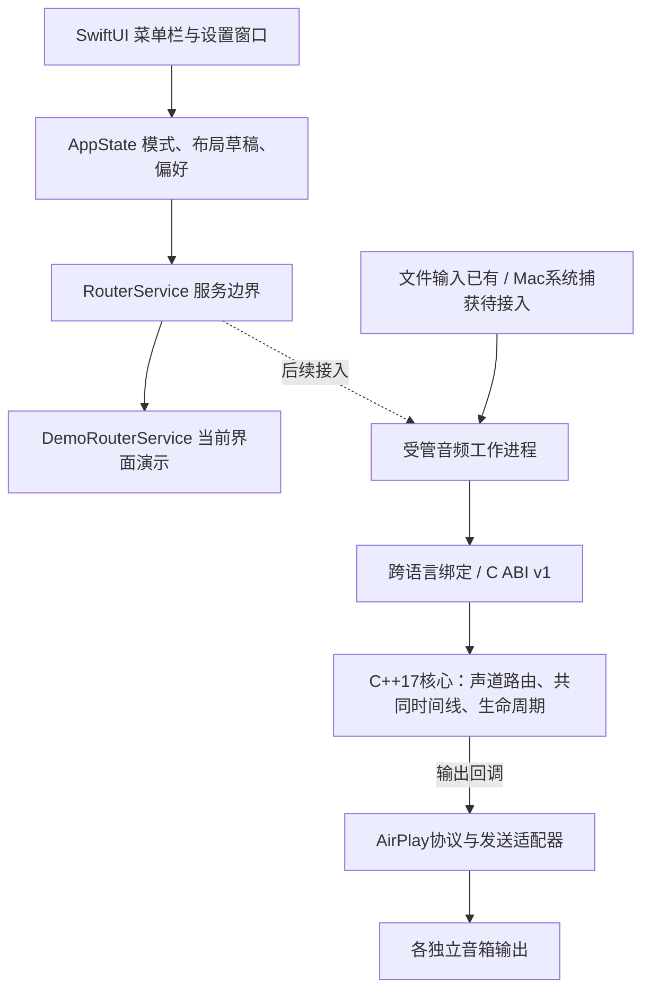

# HomePod Flow：App与核心分层

2026-11-05，UI并行开发后的架构记录。冻结核心、现有Python发送适配保持独立；不把视图接入协议库，不把Swift引进共享核心。

## 当前模块与职责

| 模块 | 目录 | 约束 |
|---|---|---|
| 原生UI | apps/macos/HomePodFlow/Views | 只读写App状态，不直接发音频 |
| 业务状态 | apps/macos/HomePodFlow/State | 单一状态源，草稿/已保存区分；同步模式只读 |
| App模型 | apps/macos/HomePodFlow/Models | 标准化坐标与逻辑位置；不是距离声学校准 |
| 服务边界 | apps/macos/HomePodFlow/Services | 当前仅演示启停/不支持结果；后续真实异步事件与worker单独扩展 |
| 跨语言入口 | core/include/flow/bridge.h、bindings/python | 冻结9符号、错误码、回调、所有权与时间语义 |
| 可移植核心 | core/src | 不依赖macOS、SwiftUI、设备IP或pyatv |
| 传输适配 | adapters/airplay_pyatv | 设备/协议、共同准备与发送、有限长持续输入和有界队列 |

RouterService属于App内部接口，当前不是新的公共跨平台ABI。后续真实worker需补命令ID、会话generation、能力与确认事件，不让Demo布尔状态直接复用为连接成功。核心共同时间线与AirPlay协议时间映射仍由原有核心/适配器负责。

## 不变与未完成

C ABI v1继续冻结；本轮35个M2保护文件SHA全部匹配，UI没有改核心、绑定或传输。Mac/Windows/Linux可以各自实现捕获和传输接入，共享核心源码及对应平台编译产物；不能跨系统直接复用同一个二进制。

当前UI保存的音量、模式和音画偏移是本机偏好，不等于声音已经应用。坐标拖动先实现编辑/保存，不代表已完成自动空间算法。系统捕获、原生立体声对、真实UI播放服务、断线恢复、毫秒级声学验证仍为后续独立任务。

## 0.2文件服务与Tap后续

文件服务真实链路已接通并通过native离线端到端、原生中途停止/EOF；当前文件测试入口由独立WorkerStore管理，主菜单Demo保留。阶段过渡不能让Demo开关控制真实会话；后续统一异步RouterService。用户已选择Core Audio Process Tap作为Mac采集兜底，放在工作进程/核心前的采集适配层；具体平台生命周期与接口见PROCESS_TAP_PLAN.md。Tap采集库与实时发送桥分开验收。
