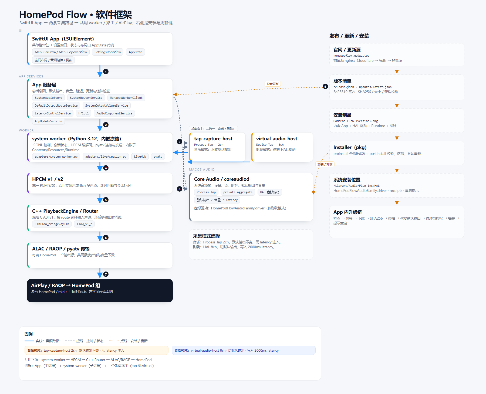

# 软件框架

日期：2026-11-18。本文是当前软件结构与目标双模式架构的框架图，不代表图中每条路径都已完成产品验收。

## 分层

- **SwiftUI App（LSUIElement）**：菜单栏 popover、设置窗口、AppState、空间布局。
- **App 服务层**：SystemAudioStore（会话意图/模式）、SystemRouterService + ManagedWorkerClient（JSONL 控制）、DefaultOutputRouteService、SystemOutputVolumeService、LatencyControlService、AudioComponentService、AppUpdateService。
- **内嵌 Runtime**：`system-worker`（Python 3.12 冻结）、`tap-capture-host`、`virtual-audio-host`、`libflow_bridge.dylib`、`hflctl`。
- **采集（二选一）**：
  - 音乐：`tap-capture-host`，Core Audio Process Tap，2ch，默认输出不变；
  - 影院：`virtual-audio-host`，HAL 虚拟设备 Device Tap，8ch，切换默认输出并写入 latency。
- **共用下游**：HPCM v1/v2 → C++ PlaybackEngine / Router（冻结 C ABI v1）→ ALAC/RAOP/pyatv → AirPlay → HomePod 组。
- **macOS 音频层**：Core Audio/coreaudiod、Process Tap + private aggregate、HAL 虚拟驱动、默认输出/音量/latency。
- **发布/更新**：官网与签名更新源、pkg/dmg、Installer、`/Library` HAL 驱动与 receipts、App 内升级链。

## 当前状态

- 影院路径（virtual）已接入 0.3.3/build4；
- 音乐路径（tap host）代码存在，但产品接线、TCC/静音提示、模式切换状态机和真机验收仍未完成；
- 两条路径共用 worker、HPCM、C++ Router 和 ALAC/RAOP，这是“同一套接口、不同采集后端”的基础。

详细评估见 [AUDIO_CAPTURE_OPTIONS_2026-11-18.md](AUDIO_CAPTURE_OPTIONS_2026-11-18.md)。
