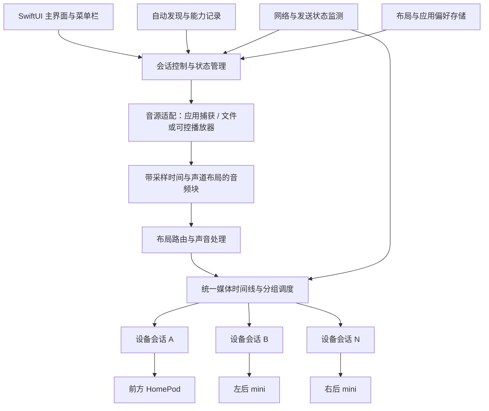

# HomePod Spatial Router：产品架构与自动化方案

日期：2026-11-05。本文是建议的产品与工程设计，尚未实施的模块均不代表已经验证可用。需求来源为用户提供的功能需求文档，已完成能力以《实现方案与测试记录》为准。

## 1. 产品方向与当前基础

目标：一次授权、一次确认摆位，之后在常用应用里播放，软件自动连接 HomePod、分配声音并维护共同播放时间线。需要恢复或兼容性受限时，给出具体状态与可执行操作。

已完成：Windows 原型从真实 5.1 文件生成三路不同音轨，向三台独立 HomePod 发送；用户确认实际出声及短时听感基本同步。Mac 已安装 Xcode 26.6、Python 和音频依赖，完成 SwiftUI 编译检查。

未验收：Mac 实时捕获与持续发送、毫秒级出声同步测量、长时间漂移、暂停/跳转/休眠恢复、第三方视频音画同步、原生 HomePod 立体声对。

首版支持用户目前的三台独立设备；数据模型从一开始支持任意数量和输出组。原生立体声对在单独验证前显示为暂不支持，不能根据发现广播就标记为可正常播放。

## 2. 面向用户的流程

首次使用只做以下事情：

1. 解释用途并请求实际需要的音频捕获、局域网访问等系统权限。
2. 自动发现 HomePod；用户选择本房间使用的设备，避免占用其他房间音箱。
3. 用户确认前方、左后、右后；提供当前三台的预设。可选短报号试听，报号会出声，需用户主动启动。
4. 保存布局、音源偏好、音量平衡和兼容性结果。

日常默认捕获选定的媒体应用；提供“整个 Mac”选项。全局捕获会包含通知声等，不应将其当作所有人的默认偏好。按 bundle ID 跟踪应用及子进程，避免浏览器进程更换后丢失来源。音量不继承实验阶段的 100%，设备变更和恢复时采用渐入。

主界面仅展示：启用开关、当前音源、房间与在线设备、音效模式、主音量、音画偏移及是否能生效。布局、设备平衡和诊断放进设置。菜单栏提供启用、音量、房间切换和恢复本机播放。

首次摆位确认与系统授权不能自动省略。软件不能可靠地仅凭名称/IP 判断物理位置，也不能仅靠网络消息判断沙发处实际声压。

## 3. 软件模块

根据用户提出的跨 macOS、Linux、Windows 复用目标，采用跨平台核心库与平台适配器。接口定义、依赖方向和迁移步骤详见[跨平台模块与接口设计](跨平台模块与接口设计_2026-11-05.md)。建议三个部署边界；内部进一步拆分为可独立测试的库：

| 模块 | 实现建议 | 主要职责 |
|---|---|---|
| 原生 App | Swift / SwiftUI | 设置、菜单栏、权限、设备和会话控制 |
| 跨平台核心库与捕获适配器 | 核心优先 C++，通过稳定 C 接口供 Swift 等调用；捕获采用各平台原生 API | 核心负责路由、时间线、调度及恢复策略；捕获适配器负责获取平台音频 |
| AirPlay 传输服务 | 首期复用 Python/pyatv，独立受管进程，封装在传输接口后 | 连接、协商、编码与协议报文、发送及设备反馈；执行同步核心的计划 |

App 负责启动/停止并监督传输服务，不安装常驻系统服务。开发期使用现有虚拟环境；交付版本必须内置可运行依赖，用户不需要安装 Python、Homebrew、FFmpeg 或输入终端命令。正式对外分发前再完成打包、签名与公证验证。

UI/控制消息走本地 IPC。实时音频通过有界共享缓冲等方式传递，不通过逐块 JSON/Base64 传输。原生实时回调只复制音频块，不等待网络、不执行 Python、不写日志、不做文件读写和无界分配。

协议层先封装现有成功方案；将目前进程内 monkey-patch 收敛到固定版本的适配层或可维护的依赖补丁，增加针对性回归。是否迁移到原生传输实现，由实时性能和维护成本实测决定；第一阶段不重写全部协议。

## 4. 音源接入

首选验证 Core Audio Process Tap，捕获指定应用/进程组或整体输出。Apple 官方提供此方向的系统接口。ScreenCaptureKit 作为兼容性备选，能力和权限需分别验证。

捕获链必须处理原应用的本机声音：接管时防止 Mac 与 HomePod 重复出声；停用、异常退出后恢复合理本机输出。不能简单假设“捕获成功”就自动静音。优先验证 tap 自带的静音/路由行为和恢复机制；不以全局静音系统作为默认方案。

所有输入携带实际采样率、实际声道数/布局和时间戳。输入是两声道就标记为两声道，不能根据影片文件名或网页标识猜成 5.1。应用输出阶段可能已降混，捕获接口不能保证取得文件原始多声道。

本地多声道优先经文件/播放器适配器读取并解码；这也是校验原始声道和可控视频同步的基准输入。虚拟多声道声卡仅在标准接口无法满足所需播放器时再研究，不作为首版默认安装步骤。

受保护内容、捕获静音或权限丢失要显示真实结果。实时流不能先录成文件再发送；需要持续读取、处理和推送，并保持可控队列长度。

## 5. 声道与声音质量

内部使用浮点音频、明确的声道标签和统一采样时间。布局路由矩阵由软件根据物理位置生成，用户不编辑系数。

| 实际输入 | 自动模式建议 |
|---|---|
| 单声道 | 前方清晰播放，后方默认保持安静 |
| 立体声 | 默认保真；当前只有一个前方音箱时需明确发生前方合并；提供可选轻度空间增强 |
| 原生 5.1/7.1 | 前方内容合理合并到可用前方设备，环绕按位置分配，低频衰减混入合适设备 |
| 声道布局未知 | 保守处理并提示格式，不猜测声道顺序 |

三台现有音箱不能完整还原标准六扬声器 5.1 的独立方向，尤其前方左右已合并。产品名称可称布局环绕，但应说明实际来源和输出布局。

立体声增强默认关闭或低强度，可研究中侧信息、去相关与频段约束，避免直接将相同全频人声大声复制到后方。算法需对单声道兼容性、相位和人声清晰度试听验证。第一阶段不引入 AI 分离和 Atmos 对象解码承诺。

混音保留余量、渐变音量；各路处理延迟必须一致。若使用不同前瞻/滤波器，统一补偿延迟。全组限幅策略应避免后方峰值单独改变各路时间关系。设备相对音量保存，缺失设备后重新生成矩阵，保证对白和关键声音仍可听见。

## 6. 同步引擎与自动恢复

同步的对象是“同一媒体采样在不同设备预期何时播放”，不是“同时执行三个播放函数”。

建议工作方式：

1. 给所有输入块建立统一单调媒体时间线、采样索引和播放世代编号。
2. 对每台接收设备估计时钟映射、可用延迟和连接能力；不同设备的协议时间戳允许不同，但要对应同一预期出声时刻。
3. 全组准备就绪后选择未来共同开始时刻，按统一预算预缓冲。
4. 持续维护同步消息及有界队列；监测本机欠载、网络请求、连接状态和可获得的接收端计时信息。没有接收端真实播放头反馈时，不能声称掌握其精确播放位置。
5. 对可观测、可估计的时钟偏差做平滑时间映射或小幅重采样修正；不能单凭网络抖动就改速，也不能让各路缓冲独立无限增长。
6. 大偏差、时间戳跳变或断线后，在新的共同时间点重新加入；必要时全组短暂渐出再同步。丢弃旧世代的排队音频，防止恢复后播放过期对白。

正常状态机：待机 → 发现/连接 → 预缓冲 → 播放 → 恢复/重新同步 → 播放。捕获在持续但没有声音，与来源真正停止是不同状态；恢复动作应尽量静默，长时间无声时再释放会话。不能因每次短暂停顿都重新连接 HomePod。

后方设备断开可暂时降混到剩余设备；前方设备缺失时，要确保对白可听，并按用户保存的策略恢复本机播放或等待。不能把前方完全静音却仍显示正常。其他人通过 Siri/系统接管音箱时，应识别会话丢失并退让，避免无限抢占重连。

网络时间映射可维护传输同步，但不能直接证明房间内真实出声误差；最终仍需录音测量。空间位置带来的声传播差异也是声学到达时间的一部分。协议同步自动维护；可选的一次座位录音校准作为后续增强，不要求用户日常逐台调延迟，也不常开麦克风。

## 7. 音画同步必须单独设计

AirPlay 带有播放缓冲；当前原型中的 1.5 秒为协议调度参数，并非实测端到端延迟。实际延迟需对不同模式测量。

当浏览器画面先显示、音箱声音后到，额外增加音频延迟无法修复；软件也不能播放尚未获得的未来音频。需要控制视频延迟或由播放器提供合适的同步接口。

因此将来源分为：

| 来源能力 | 提供体验 |
|---|---|
| 纯音乐/音频 | 自动连接和声音同步，不涉及画面 |
| 软件可控制的视频时间线 | 基于统一时间线延迟画面，自动应用已测延迟；统一偏移用于微调 |
| 第三方播放器有可用适配接口 | 按实际接口控制或保存相应配置，逐一验收 |
| 任意浏览器/第三方视频无控制接口 | 可捕获声音，但不能承诺自动音画同步；显示所需补偿方向及限制 |

保留一个面向用户的音画偏移项，但只对支持的方向和范围启用。恢复默认值、应用级记忆和自动建议都围绕同一个参数实现。不能把输出缓存无限降低当作普遍解决办法。

## 8. 自动化边界

| 软件自动完成 | 首次或发生变化时需要用户参与 |
|---|---|
| 发现设备、识别 IP 变化、恢复上次房间 | 确认本房间使用哪些音箱及物理位置 |
| 识别实际输入格式、生成路由 | 必需的系统隐私权限 |
| 连接、预缓冲、同步、网络恢复 | 苹果侧要求的配对/认证（若出现） |
| 音量渐入、设备缺失后重新分配 | 主动选择启动报号或录音校准 |
| 保存应用偏好、重启/唤醒恢复 | 不可控视频来源的兼容性选择 |

只为持续失败或需要行动的事件提示，避免每次重试弹窗。状态显示“连接与发送正常”“正在恢复”等可证明的信息；没有持续声学监测时，不显示伪造的“实际误差 0 ms”。日志默认本地保存技术元数据，不记录音频内容。

## 9. 开发与验收顺序

以下数字为建议验收目标，尚未实测达成，应在基准测试后调整；每次报告注明输入、位置、网络、系统/固件与分析置信度。

| 阶段 | 交付 | 主要通过条件 |
|---|---|---|
| A：Mac 端同步基线 | 三台独立设备、共同时间线、不同信号、测量报告 | 完成已有录音分析并在 Mac 重测；30 次启动、连续 2 小时；以成对起音差 p95 ≤ 5 ms、显著超差 > 10 ms 为初始工程目标，同时评估测量误差与听感 |
| B：日常音乐原型 | 应用捕获→实时处理→三路持续推送，基础 UI | 先覆盖一个浏览器和一个音乐应用；暂停/恢复、应用重开、睡眠唤醒与设备重连不需用户重启软件；Mac 本机不重复出声 |
| C：可控视频与真实多声道 | 文件/播放器适配、5.1 路由和音画补偿 | 可控来源自动音画匹配，初始目标残差 ≤ 40 ms；任意浏览器来源如不支持则明确标识；不能为赶目标伪装成双向可调 |
| D：产品稳定化 | 安装包、偏好、菜单栏、自由布局、诊断 | 断线/设备增减/网络变化/应用崩溃恢复；连续 8 小时、多次冷启动；记录恢复耗时、失败比例和 CPU/内存 |
| E：扩展兼容性 | 原生立体声对、更多来源、空间增强 | 每项独立通过真实设备验收后才对用户启用 |

阶段 A 应先在 Mac 上迁移已有发送方案；阶段 B 必须新增持续数据源接口，不能用文件发送 API 反复启动来冒充实时接管。阶段 D 的自动恢复基础设计从 B 开始实现，不能等到发布前才补。

声学测试使用不同信号并保持共同已知起音；分析需区分反射、传播距离和阈值误差。协议日志用于辅助定位，不能替代实际出声证据。此类验收需要设备现场配合，但不属于日常用户必须执行的步骤。

## 10. 下一步具体任务

第一步做 Mac 上三台音箱的持续推流与同步测量，复用当前已成功的 ALAC/共享时间线方案。第二步加入单应用实时捕获，并解决本机重复出声和流中断。第三步实现最小原生界面与保存/恢复。视频控制和多声道保留的兼容性实验应并行于功能设计尽早完成，避免后期才发现目标来源无法满足要求。

## 参考

- [既有原型实现与测试](HomePod_Spatial_Router_实现方案与测试记录_2026-11-04.md)。
- [Mac 开发环境](MacBook开发环境_2026-11-05.md)。
- [Apple：Capturing system audio with Core Audio taps](https://developer.apple.com/documentation/coreaudio/capturing-system-audio-with-core-audio-taps)。
- [Apple：Meet ScreenCaptureKit](https://developer.apple.com/videos/play/wwdc2022/10156/)。
- [pyatv 协议文档](https://pyatv.dev/documentation/protocols/)：项目明确说明相关协议知识来自逆向工程；系统/固件更新后的兼容性要回归验证。

上述系统接口用于捕获和基础能力，不等于苹果提供了本项目所需的完整多 HomePod 独立声道发送 SDK。传输兼容性仍依赖选定实现及现场验证。
