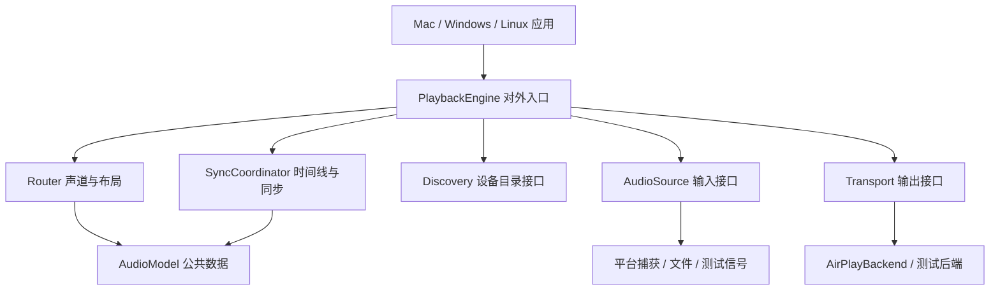

# HomePod Spatial Router：跨平台模块与接口设计

日期：2026-11-05。状态：架构建议与接口草案，尚未完成库化实现。补充并调整《产品架构与自动化方案》中的技术分层。

## 1. 核心决策

Mac 是首个产品平台。音频路由、播放编排、时间线、同步策略等作为跨平台库，UI、系统声音捕获、权限和系统生命周期作为平台适配器。

先在 Mac 交付完整链路，同时让核心库能在 Windows 和 Linux 构建及运行离线验证。其他平台的音频捕获和产品界面后续实现，不预先承诺跨平台功能一致。

优先采用 C++ 实现共享核心，对外提供小型、版本化 C ABI，再提供 Swift/Python 等包装。跨边界使用固定宽度类型、句柄和显式释放接口，不暴露 C++ STL、异常或编译器相关对象。初期无需重写已有 Python 协议代码。

模块是职责与库边界，多数模块可以链接在同一个进程。只将现有 Python 传输后端作为受管子进程；后续原生后端可以同进程运行。接口本身不强制一种部署方式。

## 2. 依赖关系



UI 只依赖引擎的公共控制接口、数据模型和事件。Router、SyncCoordinator 不依赖 UI、HomePod 名称、IP、pyatv 或 macOS 类型。AirPlay 实现通过 Transport 接入，由组合层注入，核心不直接 import 协议库。

## 3. 模块及其接口职责

以下接口名用于说明语义，具体 ABI 另行落实。

| 模块/库 | 对外接口示例 | 职责与边界 |
|---|---|---|
| AudioModel | AudioFormat、AudioBlock、MediaTime、OutputId、Capabilities | 统一采样格式、声道标签、时间戳和错误语义；不包含平台对象 |
| AudioSource | enumerate / open / start / stop / onBlock | 文件、测试信号或系统捕获；输出实际格式与来源时间戳；报告 discontinuity |
| Discovery | watch / snapshot / onChanged | 提供稳定设备标识、当前地址、输出组及能力；不决定房间位置 |
| Router | configure(layout, inputFormat) / process | 声道分配、增益及处理延迟声明；不负责网络播放时机 |
| SyncCoordinator | plan / observe / reconfigure / newEpoch | 共同媒体时间、预缓冲预算、每路播放计划、偏差策略；不构造 AirPlay 报文 |
| Transport | capabilities / prepare / enqueue / flush / close / onFeedback | 将播放计划映射为协议操作，编码、发送、计时交换；不自行改变全组同步策略 |
| PlaybackEngine | configure / prepare / start / submit / stop / setVolume / onEvent | 将以上模块组成完整会话；管理任务生命周期、异常、设备增减和恢复 |
| VideoController | capabilities / setPresentationOffset / seek | 可选视频时间线控制；不支持的来源明确返回能力不足 |
| PlatformServices | MonotonicClock、CredentialStore、Lifecycle | 统一时钟抽象、凭据与系统休眠事件；各平台实现 |

Discovery、AudioSource、Transport 等属于可替换接口，首个实现可以与相关代码放在同一构建目标；无需一开始就发布大量包或实现动态插件加载。

## 4. 播放库与同步库如何合作

PlaybackEngine 提供“多路不同内容的同步播放”能力。三路只是 outputs 列表长度为 3，不写死 front/rear-left/rear-right 三个参数，更不写死三台 IP。

示意调用：

```text
engine.configure(outputs, layout, sourceFormat, syncPolicy)
engine.prepare()                    // 协商各路能力并准备会话
engine.start()                      // 引擎内部建立共同未来播放起点
engine.submit(audioBlock)           // 输入块携带 epoch、采样索引与格式
engine.setMasterVolume(value)
engine.stop()
```

流程：来源提供 AudioBlock → Router 生成各路音频块 → SyncCoordinator 给出共同时间线对应的各路目标播放时间 → Transport 实现目标时间、编码和发送 → 反馈交回 SyncCoordinator 和会话状态机。

独立输出接口允许测试单台设备，但产品正常多路播放从 PlaybackEngine 入口进入，保证每路共享组状态。Transport 不能偷偷增加一路的固定缓存而不通知同步模块，也不能自行用新起点重连后直接加入旧组。

同步库可以用模拟时钟和模拟接收端测试；传输库可以用单路文件/测试信号验证；完整引擎用多设备测试验证。各层通过同一组公共数据联系，禁止从同步模块修改协议库私有对象作为长期正式接口。

## 5. 跨模块最重要的数据契约

### 音频块

- 格式：采样率、Float32 等样本格式、明确的声道标签与平面/交错布局、帧数。
- 时间：流标识、播放世代 epoch、该块首帧的媒体采样索引，以及来源时钟到统一时间线的映射信息。
- 缓冲所有权：是借用、转移还是引用计数；谁释放、何时可复用必须明确。跨 C ABI 使用成对 retain/release 等约定。
- 格式切换、跳转、输入中断使用事件和新世代处理，不将新格式样本塞进旧格式队列。

### 时间

- 统一媒体时间以整数采样或有理数表示，避免长时浮点累积。
- 本机调度使用单调时钟；日历时间/NTP 与单调时钟的映射由适配器管理，避免系统校时导致播放跳变。
- 每个设备的协议时间戳可以不同，但必须表示同一目标媒体时刻。重采样率、处理延迟、编码延迟与协议缓冲显式上报。
- 共同时钟校正/输入速率匹配与接收端个别校正区分建模，避免各路独立改速造成新的错位。

### 能力与反馈

- 明确是否支持定时启动、清空队列、计时反馈、重传、音量，以及可接受的格式/延迟范围。
- 状态附带观测时刻、单位、来源和置信度。区分本机发送进度、接收端反馈与实际声学测量。
- 不支持定时语义的后端，不能伪装为已同步：prepare 应失败或明确进入用户可见的降级模式。
- 组内路径根据实际能力协商，不要求所有后端支持所有功能。

### 线程、队列与错误

- 控制调用与实时音频数据通道分开；回调线程、取消、完成通知和停止后的回调规则写入契约。
- 队列有上限；submit/enqueue 返回 accepted、wouldBlock、discontinuity 或具体错误，禁止静默无限堆积。
- 实时回调不等待网络、不调用 Python、不操作 UI。跨进程数据采用有界共享缓冲和显式协议，控制消息允许序列化。
- 队列满时由引擎统一决定丢弃旧数据/重同步；不能只丢一路而保留其他路旧时间线。
- 错误含模块、设备、是否可重试和原因。重连预算与全组恢复策略由 PlaybackEngine 控制，后端执行连接与关闭操作。

## 6. 平台层

| 平台 | 平台适配方向 | 共享部分 |
|---|---|---|
| macOS | SwiftUI、Core Audio 捕获、系统权限与生命周期 | 路由、同步、播放编排、AirPlay 后端 |
| Windows | Windows UI 与系统音频捕获适配器 | 同上 |
| Linux | Linux UI/CLI 与系统音频服务适配器 | 同上 |
| 无界面设备 | CLI、服务或设备自身输入适配器 | 同上；按 CPU、系统和依赖能力裁剪 |

平台捕获的应用选择、原生多声道保留和权限行为需各自验收；不能仅凭核心库可编译就宣称全功能跨平台。Accelerate 等平台优化允许藏在可替换的 DSP 实现中，基础核心不能直接依赖它。

## 7. 建议目录

```text
core/
  include/hsr/           # 对外 C ABI 与公共数据类型
  audio/                # 路由、格式转换、缓冲
  sync/                 # 时钟映射、同步计划
  playback/             # 会话编排与状态机
adapters/
  airplay-pyatv/         # 现有成功方案的封装
  source-file/
  source-test/
  capture-macos/
bindings/
  swift/
  python/
apps/
  macos/
  cli/                  # 同一引擎的验证入口
tests/
  contract/             # 所有同类后端的公共契约测试
  core/                 # 模拟时钟、队列、路由、恢复
  integration/          # 真机测量与长时间播放
```

这是目标结构，不表示仓库已有对应目录。构建可以使用 CMake 管理共享原生库，由各平台应用集成。接口明确后再按实际开发步骤建立目录，避免创建无法运行的空架构。

## 8. 从当前原型迁移

1. 固定现有成功代码和真机基线，保留可重复运行的 CLI。
2. 定义 AudioBlock、时间、Capabilities 与 Transport 契约，增加文件源和可控测试源。
3. 将 ALAC、发现与会话操作封装进 PyatvBackend，将共同起点从全局 monkey-patch 迁移到有明确协作点的适配层/依赖补丁。原后端尚不能按新接口逐块持续输入，需要实际改造后验收。
4. 提取 PlaybackEngine 和 SyncCoordinator。先保持现有声音行为，再增加流式输入、世代切换、异常恢复与长期漂移处理。
5. Mac 捕获适配器接入相同音频块接口，SwiftUI 通过 C ABI/受管服务控制引擎。
6. 用相同离线输入、模拟时钟和输出记录在三种系统验证共享核心；随后按需新增 Windows/Linux 捕获适配器。

每一步需保留现有可运行链路。接口重构本身不能算真机同步验收；接口测试证明语义，录音与长时设备测试证明实际播放结果。

## 9. 独立验证能力

- Router：已知各声道不同标记，验证映射、增益、缺设备降混及处理延迟。
- SyncCoordinator：注入时钟偏差、抖动、跳转和休眠事件，检查计划、队列边界与世代隔离。
- Transport：对能力声明、准备/关闭、队列满、flush 和反馈语义执行公共契约测试。
- PlaybackEngine：模拟源与假接收端覆盖设备增减、部分失败和恢复，避免 UI 参与测试。
- 真机：同一 CLI 调用正式引擎，进行不同内容同步、长播和录音测量。测试路径与产品路径共用核心。

这样后续增加设备平台、替换 pyatv 或修改界面时，可以明确知道需要替换哪一层、哪些测试必须重新通过。
